<h1 align="center">RCDL</h1>
<p align="center"><b>A vision application on Rockchip RK3588 in minutes, with every hardware block doing its job.</b><br>
One C++ / Python API over VPU codecs → RGA preprocessing → NPU inference → post-processing, zero-copy end to end.</p>

<p align="center">
<a href="https://github.com/ruisv/rcdl/releases"></a>
<a href="LICENSE"></a>


<a href="model_zoo/README.md"></a>
</p>

<p align="center"><b>English</b> | <a href="README.md">简体中文</a></p>

<p align="center"><a href="#install">Install</a> · <a href="#quick-start">Quick start</a> · <a href="#tasks">Tasks</a> · <a href="#performance">Performance</a> · <a href="#models">Models</a> · <a href="#documentation">Documentation</a> · <a href="#community">Community</a></p>

| | | |
|:--:|:--:|:--:|
| 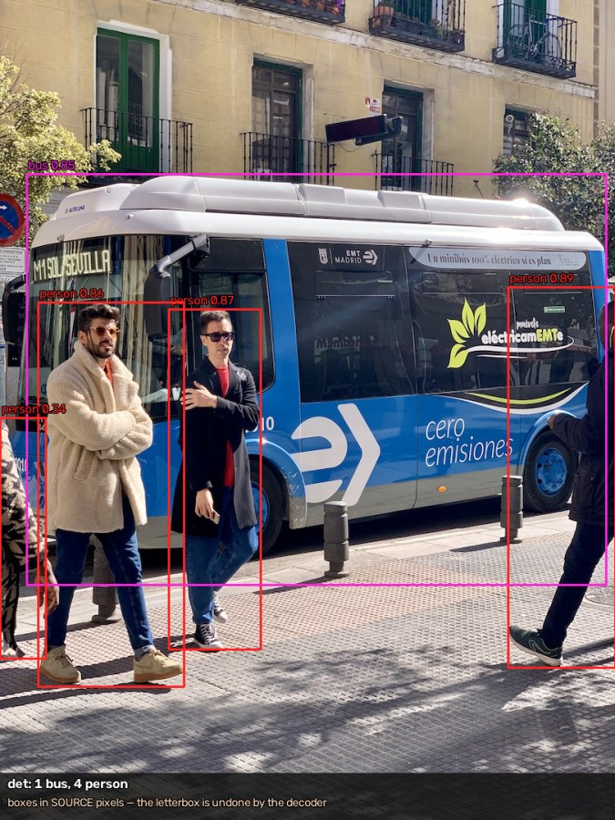 | 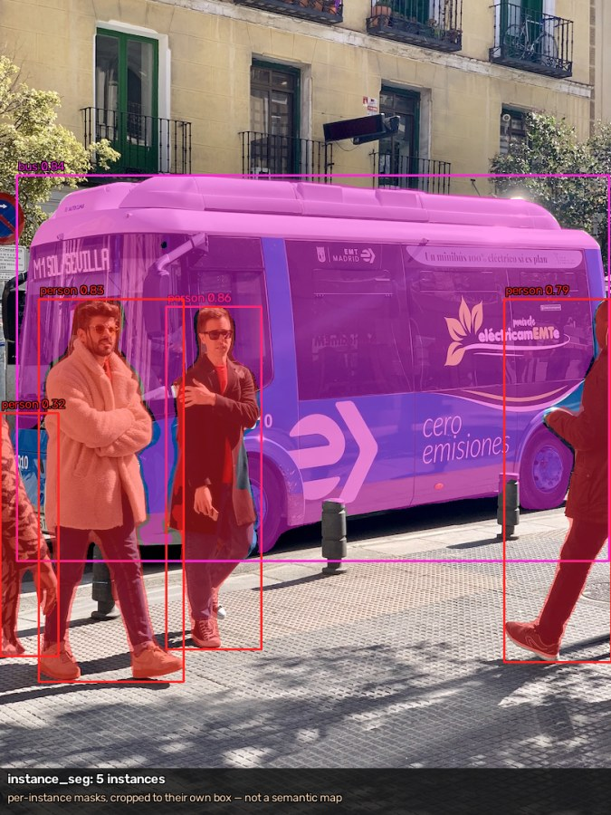 | 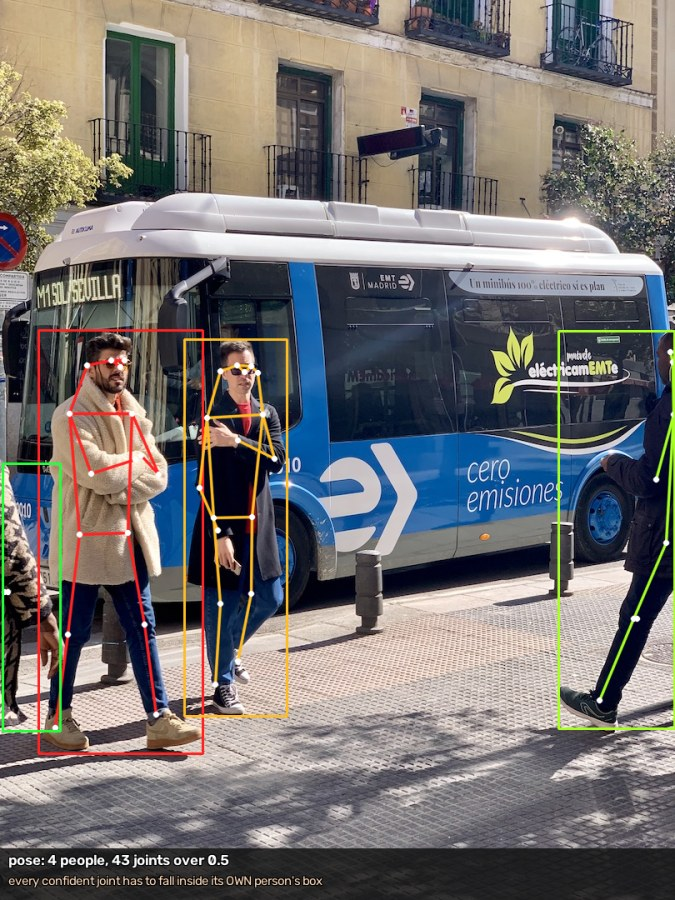 |
| Detection | Instance segmentation | Pose |
| 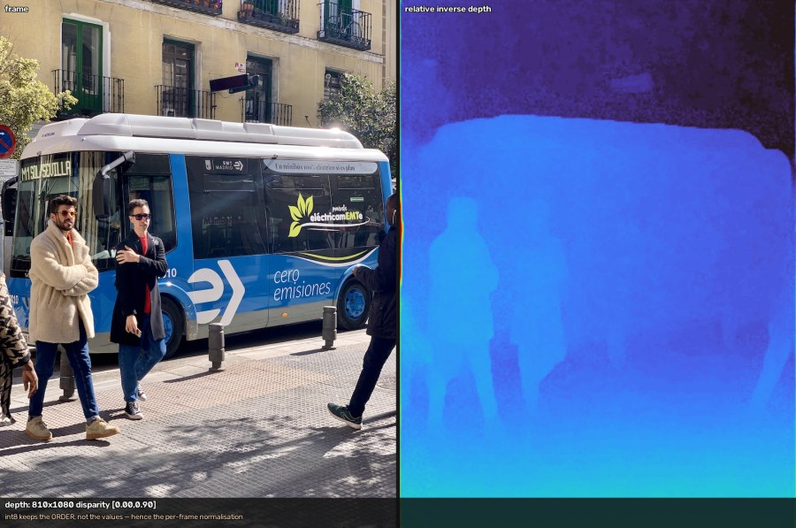 | 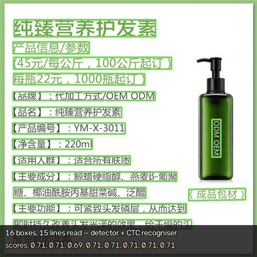 | 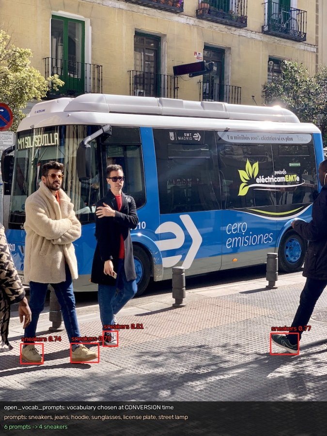 |
| Monocular depth | OCR | Open-vocabulary detection |

All 18 tasks are in the [gallery below](#gallery); every picture was produced on the board.

## Why RCDL

Rockchip ships three unrelated C libraries: `librknnrt` (NPU), `librga` (2-D
acceleration) and `MPP` (video codecs). Wiring them into one pipeline that never
copies a frame, and then getting each model's post-processing right, is usually
weeks of work. RCDL is that work, done:

- **Ten lines to a result.** An `Engine` plus a task class. Detection, segmentation, pose, OCR, faces, depth, tracking — 18 tasks work out of the box.
- **Each block does its own job.** The model runs on the NPU, scaling and colour conversion on RGA, codecs on the VPU. The CPU does post-processing, and the fallback when the hardware cannot.
- **Actually zero-copy.** The decoded frame, RGA, the NPU input tensor and the encoder share one dma-buf. There is no `memcpy` between them.
- **All three NPU cores.** The async pipeline takes detection from 99 fps to 481 fps, with results identical to the synchronous one and in order.
- **Reproducible.** Every decoder has a numpy reference test, and 587 board tests cover the full hardware path. The things RK3588's documentation does not tell you — RGA's 4 GB line, two RGA generations that resample differently — are already handled, and written up in [`docs/RGA.md`](docs/RGA.md).

RCDL is built on Rockchip's official runtimes. It does not replace them.

## Install

On the board (linux-aarch64), one command from our conda channel:

```bash
conda create -n rcdl -c https://mirrors.ruis.ai/conda -c conda-forge rcdl
conda activate rcdl
python -c "import rcdl; print(rcdl.__version__, rcdl.rga_version())"
```

That brings the Python bindings, the C++ library and the Rockchip userspace
libraries (`librknnrt` 2.3.2, `librga`, `rockchip-mpp`). The board image only
has to provide the kernel drivers. To add RCDL to an environment you already
have, replace `create -n rcdl` with `install`. For C++ only, install `librcdl`.

No conda on the board yet? Install [Miniforge](https://github.com/conda-forge/miniforge) once:

```bash
curl -LO https://github.com/conda-forge/miniforge/releases/latest/download/Miniforge3-Linux-aarch64.sh
bash Miniforge3-Linux-aarch64.sh -b -p ~/miniforge3 && ~/miniforge3/bin/conda init && exec "$SHELL"
```

**Requirements:** an RK3588 / RK3588S board, Linux aarch64, RKNPU driver ≥ 0.9.x,
and your user in the `video` and `render` groups. RK3576 / RK356x are not yet verified.
Building from source, permissions and troubleshooting are in
[`docs/INSTALL.md`](docs/INSTALL.md).

## Quick start

First download a compiled model (YOLOv8n, 4 MB) and a test image. The other models are listed under [Models](#models):

```bash
curl -LO https://huggingface.co/ruisv/rcdl-yolo/resolve/main/yolov8n_rk3588.rknn
curl -LO https://raw.githubusercontent.com/ruisv/rcdl/main/data/images/bus.jpg
```

**Find objects in an image (Python)**

```python
import cv2, rcdl

det = rcdl.Engine("yolov8n_rk3588.rknn").detector(model_input="rgb888")
for d in rcdl.detect(det, cv2.imread("bus.jpg")):
    print(rcdl.coco_class_name(d.class_id), f"{d.score:.2f}", d.x1, d.y1, d.x2, d.y2)
```

Boxes come back in original-image pixels. Grids, class count, DFL and channel
layout are read from the model, and a model that does not match raises at
construction instead of quietly decoding garbage.

**Video in, annotated video out, and the frame never leaves the hardware**

```python
enc = None
with open("annotated.h264", "wb") as out:
    for frame in rcdl.decode_video("clip.h264"):             # VPU decode; the frame is a dma-buf
        dets = det.process_frame(frame)                      # RGA writes straight into the NPU input tensor
        frame.draw_rects([(d.x1, d.y1, d.x2, d.y2) for d in dets])
        enc = enc or rcdl.VideoEncoder(width=frame.width, height=frame.height)
        while not enc.feed_frame(frame):                     # VPU encode, reading the same dma-buf
            out.write(enc.receive(5) or b"")
        while (pkt := enc.receive(0)) is not None:
            out.write(pkt)
    while (pkt := enc.flush()) is not None:
        out.write(pkt)
```

For throughput use `engine.video_detector()`: decode, preprocessing and
three-core inference all run in C++ threads, 72–97 fps on 1080p H.264 → YOLOv8n.

**C++**

```cpp
#include "rcdl/rcdl.h"

rcdl::Engine engine("yolov8n_rk3588.rknn");
rcdl::PipelineConfig cfg;
cfg.model_input = rcdl::PixelFormat::RGB888;
rcdl::DetectionPipeline pipe(engine, cfg);

for (const rcdl::Detection& d : pipe.process(frame.view()))   // frame: a decoded frame or any ImageView
  std::printf("%s %.2f\n", rcdl::cocoClassName(d.class_id), d.score);
```

```cmake
find_package(rcdl REQUIRED)
target_link_libraries(app PRIVATE rcdl::rcdl)
```

More in [`examples/`](examples): twenty-odd standalone programs covering
detection, segmentation, depth, SAM, optical flow, super-resolution and the
video pipelines.

## Tasks

| Task | Python entry point | Verified models |
|---|---|---|
| Object detection | `engine.detector()` | YOLOv8 · YOLO11 · YOLO26 |
| Open-vocabulary detection / segmentation | `engine.detector()` · `engine.instance_segmenter()` | YOLOE-11s |
| Classification | `engine.classifier()` | ResNet-18 · YOLO26-cls |
| Instance segmentation | `engine.instance_segmenter()` | YOLOv8-seg · YOLO26-seg |
| Semantic segmentation | `engine.segmenter()` | PP-LiteSeg · YOLO26-sem |
| Promptable segmentation (SAM) | `engine.prompt_segmenter()` | EdgeSAM |
| Human pose, 17 keypoints | `engine.pose_estimator()` | YOLOv8-pose · YOLO26-pose |
| Whole-body pose, 133 keypoints | `engine.wholebody_estimator()` | RTMW-s |
| Oriented boxes | `engine.obb_detector()` | YOLOv8-obb · YOLO26-obb |
| Monocular depth | `engine.depth_estimator()` | Depth-Anything-V2-Small |
| OCR (detection · direction · recognition) | `engine.text_detector()` and friends | PP-OCRv4 · v5 · v6 |
| Face detection + recognition | `engine.face_detector()` · `engine.face_recognizer()` | RetinaFace · ArcFace R50 |
| Image / person embeddings | `engine.embedder()` | SigLIP · OSNet |
| Sparse features and matching | `engine.feature_extractor()` | XFeat |
| Dense optical flow | `engine.flow_estimator()` | NeuFlow v2 |
| ×4 super-resolution | `engine.upscaler()` | Real-ESRGAN Compact |
| Panoptic driving (detection + drivable area + lanes) | `engine.anchor_detector()` · `engine.segmenter()` | YOLOP |
| Multi-object tracking | `engine.tracker()` | ByteTrack + BoT-SORT appearance association |

Every task is an engine-free pure decoder, a numpy test and a board test. The
C++ classes mirror these one to one; see [`docs/CPP_API.md`](docs/CPP_API.md).

## Performance

Measured on RK3588S (librknnrt 2.3.2, driver 0.9.8). The full table and how to
rerun it are in [`benchmarks/RESULTS.md`](benchmarks/RESULTS.md).

| | |
|---|---|
| ResNet-18 int8, one core / three cores | 4.0 ms · **707 fps** |
| Detection pipeline, synchronous / async on three cores | 99 fps · **481 fps** |
| 1080p H.264 decode / 4K H.265 decode | **324 fps** · **244 fps**, every frame a dma-buf |
| 1080p H.264 encode, reading decoded frames directly | **197 fps** |
| Compressed video → detections (1080p, YOLOv8n) | **72–97 fps** |

## Models

Compiled `.rknn` files, verified on the board, are published on Hugging Face and
load as downloaded. Each repo's model card gives the measured speed and accuracy,
a working snippet, and what to know before deploying:

| repo | what is in it | licence |
|---|---|---|
| [`ruisv/rcdl-yolo`](https://huggingface.co/ruisv/rcdl-yolo) | YOLOv8n · YOLO11n · YOLO26n: detection, instance segmentation, pose, oriented boxes, classification | **AGPL-3.0** |
| [`ruisv/rcdl-ppocr`](https://huggingface.co/ruisv/rcdl-ppocr) | PP-OCR v4 · v5 · v6: text detection, direction and recognition, with dictionaries | Apache-2.0 |
| [`ruisv/rcdl-depth-anything-v2-small`](https://huggingface.co/ruisv/rcdl-depth-anything-v2-small) | monocular relative depth | Apache-2.0 |
| [`ruisv/rcdl-siglip-b16`](https://huggingface.co/ruisv/rcdl-siglip-b16) | image embeddings, zero-shot classification | Apache-2.0 |
| [`ruisv/rcdl-xfeat`](https://huggingface.co/ruisv/rcdl-xfeat) | sparse features and matching | Apache-2.0 |
| [`ruisv/rcdl-superres`](https://huggingface.co/ruisv/rcdl-superres) | ×4 super-resolution | BSD-3-Clause |

From a checkout, `scripts/fetch_models.sh` fetches all of them into `models/` and
checks each against its SHA-256. `HF_ENDPOINT` points it at a mirror.

- **The YOLO family is Ultralytics' AGPL-3.0.** Software that ships these models or serves them over a network falls under AGPL-3.0 too; closed-source or commercial use needs an Ultralytics Enterprise licence.
- **Why the other verified models are not published** (non-commercial terms inherited from pretrained weights or training data, or no licence stated upstream) is set out model by model in [`model_zoo/README.md`](model_zoo/README.md).
- **For those and for your own models,** convert from ONNX with [rknn-toolkit2](https://github.com/airockchip/rknn-toolkit2) on an x86 host. A `.rknn` is tied to one SoC, and the toolkit version must not be newer than the runtime on the board. Rockchip's [rknn_model_zoo](https://github.com/airockchip/rknn_model_zoo) has download scripts and conversion examples, and its YOLO export layout is the one RCDL's decoders read.
- [`docs/MODELS.md`](docs/MODELS.md) lists, for every verified model, the input format, channel order, whether the activation is inside the graph, and the conversion traps actually hit. Channel order and activation placement cannot be read from a `.rknn`, and getting them wrong only costs accuracy silently.

## How it works

```
                    your application (C++ / Python)
                              ↓
   ┌──────────────────────────────────────────────────────┐
   │  RCDL                                                 │
   │  tasks · tracks · pipeline · media · preproc · backend │
   └──────────────────────────────────────────────────────┘
                              ↓
   librknnrt (RKNPU2)  ·  librga (im2d)  ·  librockchip_mpp (rk_mpi)
                              ↓
        NPU ×3   ·   RGA3 ×2 + RGA2   ·   VPU (decode / encode / JPEG)
```

One dma-buf goes the whole way. The VPU decodes into it, RGA imports it by fd
and crops, scales and converts NV12 → RGB in a single operation whose
destination is the input tensor the NPU already has bound; the same memory,
with boxes drawn on it, then goes to the VPU encoder. Caches are synchronised
only when the CPU touches a buffer, and never on the pure hardware path.

## Documentation

| | |
|---|---|
| [`docs/INSTALL.md`](docs/INSTALL.md) | installation, board requirements, building from source, troubleshooting |
| [`docs/API.md`](docs/API.md) | Python API |
| [`docs/CPP_API.md`](docs/CPP_API.md) | C++ API |
| [`docs/MODELS.md`](docs/MODELS.md) | verified models, each model's input contract, conversion notes |
| [`model_zoo/README.md`](model_zoo/README.md) | prebuilt models on Hugging Face, and what each model's licence allows |
| [`docs/RGA.md`](docs/RGA.md) | what RGA on RK3588 will and will not do, all of it measured |
| [`benchmarks/RESULTS.md`](benchmarks/RESULTS.md) | per-task latency and results, rerunnable on your board |
| [`CHANGELOG.md`](CHANGELOG.md) | release notes |

## Gallery

<details>
<summary>All 18 pictures</summary>

| | | |
|:--:|:--:|:--:|
|  |  | 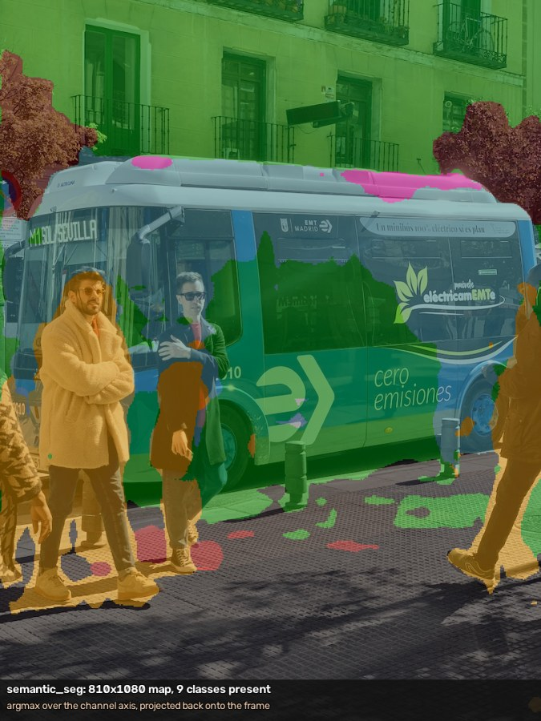 |
| Detection | Instance segmentation | Semantic segmentation |
|  | 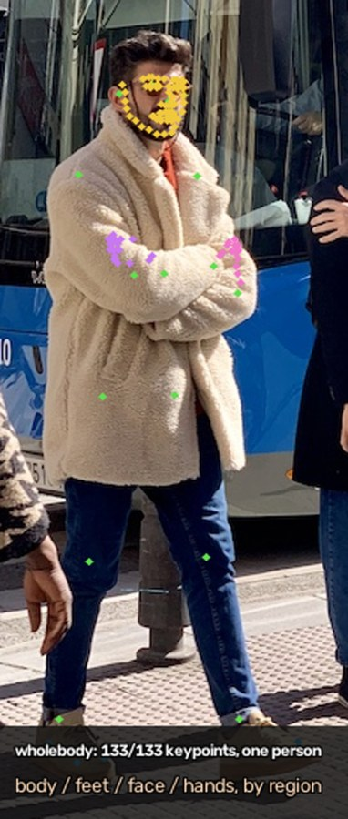 | 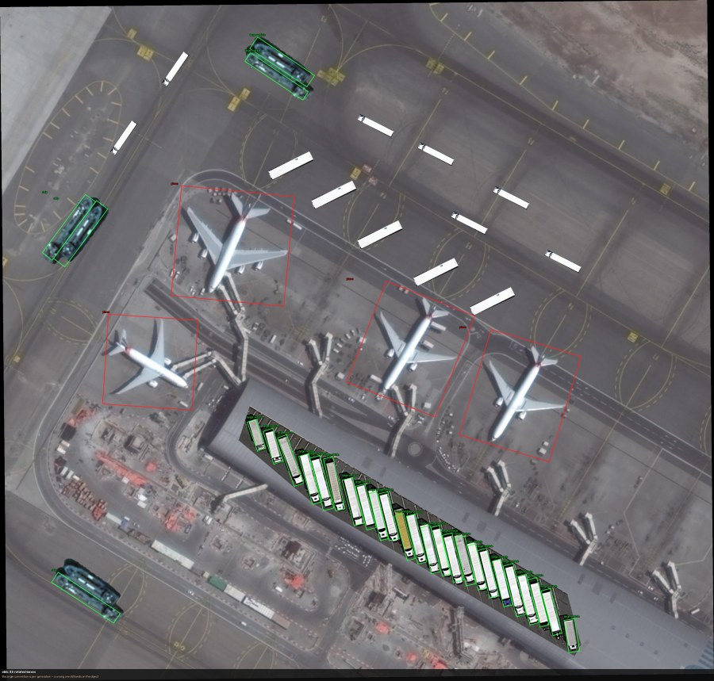 |
| Pose (17 keypoints) | Whole-body pose (133 keypoints) | Oriented boxes |
|  | 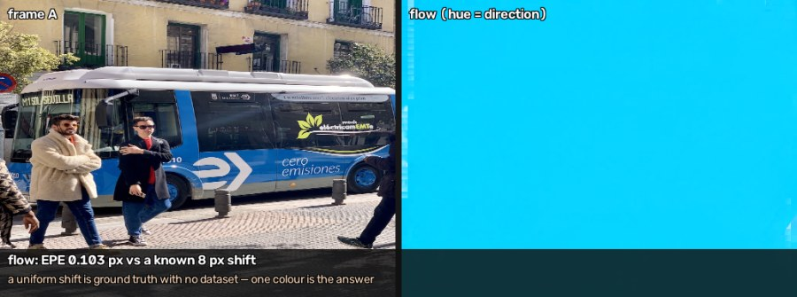 | 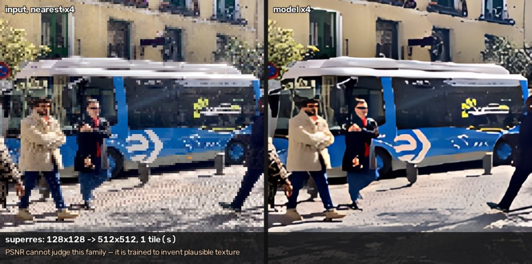 |
| Monocular depth | Dense optical flow | ×4 super-resolution |
| 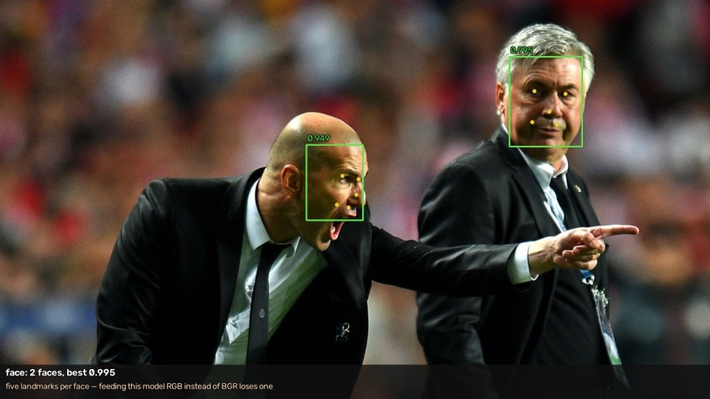 | 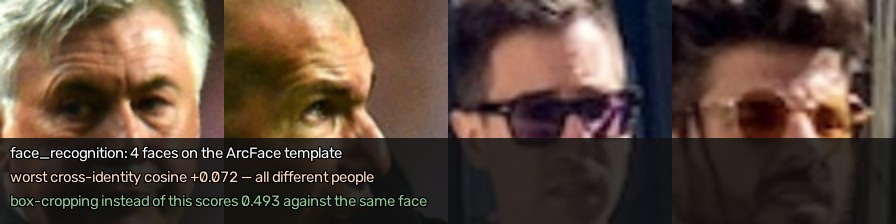 | 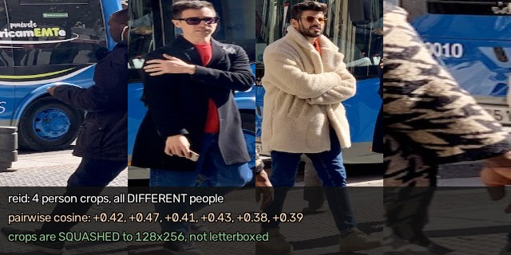 |
| Faces + 5 landmarks | Face recognition | Person ReID |
|  | 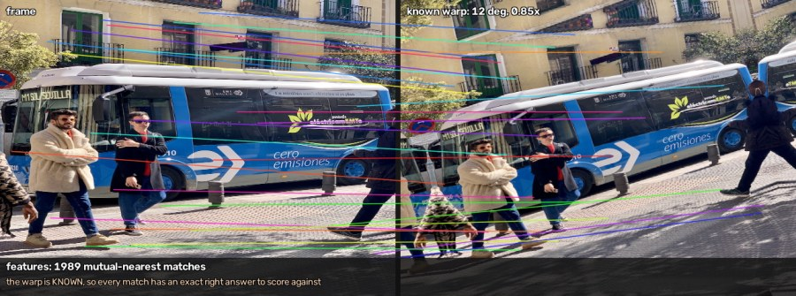 | 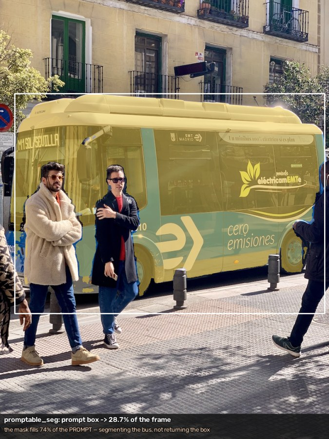 |
| OCR | Sparse features + matching | Promptable segmentation |
|  | 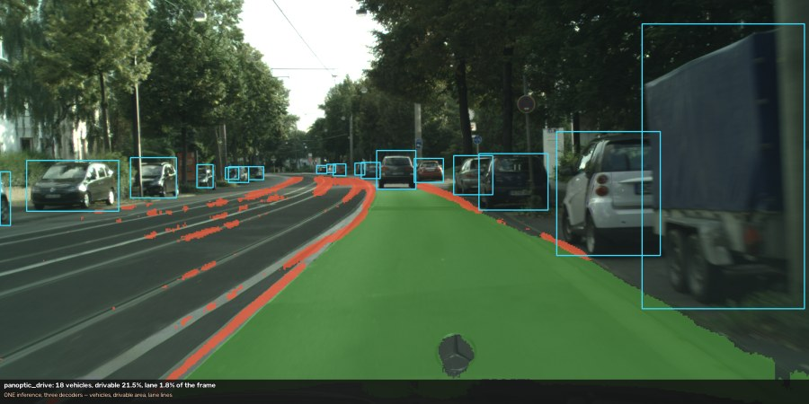 | 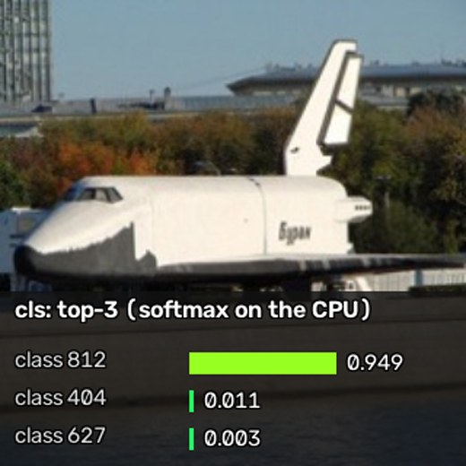 |
| Open-vocabulary detection (`sneakers`) | Panoptic driving | Classification |

Generated on the board by `benchmarks/bench.py --figures`, in the same run as
the performance table, so the pictures and the numbers describe the same build.

</details>

## Contributing

Issues and pull requests are welcome: bugs, new task decoders, and results from
other Rockchip SoCs are all valuable. Read [`CONTRIBUTING.md`](CONTRIBUTING.md)
first. For a bug report, include the SoC, the output of `model_info`, and a
minimal reproduction.

## Community

Join the **RCDL tech chat group** to discuss NPU / RGA / VPU deployment on
Rockchip RK3588 and using this project.


> WeChat group QR codes expire; the image above is refreshed in place at the same
> link. If scanning still fails, open an [Issue](../../issues) — you're also
> welcome to just discuss there.

Sister projects on D-Robotics RDK boards: [**BCDL**](https://github.com/ruisv/bcdl)
(vision) and [**BLLM**](https://github.com/ruisv/bllm) (on-device LLMs).

## Acknowledgements

- **Rockchip** — the RK3588 platform, the RKNPU2 runtime and rknn-toolkit2, RGA, MPP.
- **[BCDL](https://github.com/ruisv/bcdl)** — the sister project for D-Robotics RDK boards, where RCDL's API design and post-processing come from.
- The upstream model projects: Ultralytics YOLO, PaddleOCR, Depth-Anything, EdgeSAM, RTMW, XFeat, NeuFlow, Real-ESRGAN, YOLOP, SigLIP, OSNet, RetinaFace, ArcFace.

## License

[Apache License 2.0](LICENSE). Rockchip's runtime libraries carry their own
licenses, and model weights carry those of their upstreams; see
[`model_zoo/README.md`](model_zoo/README.md).
